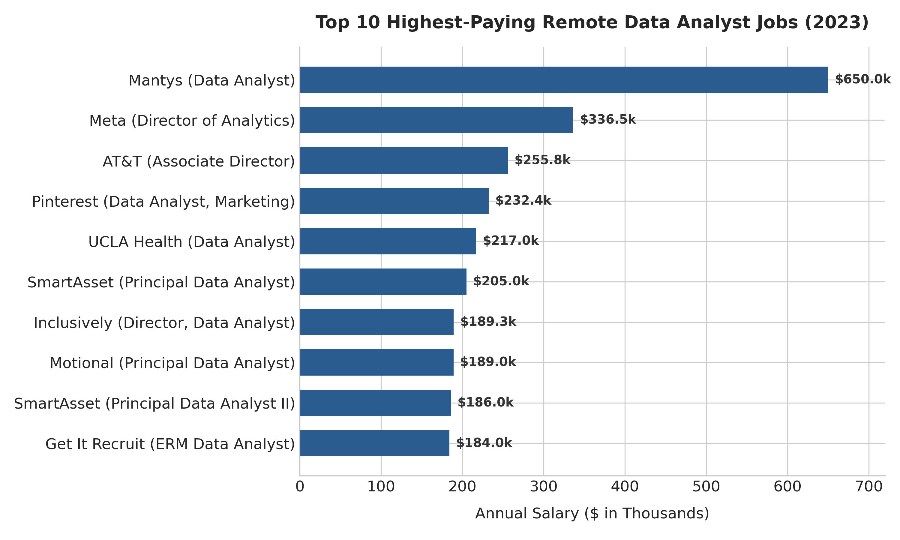
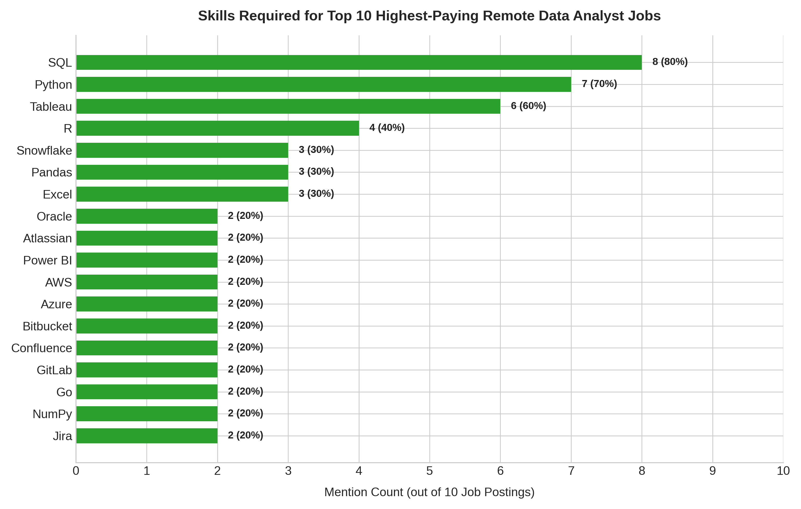
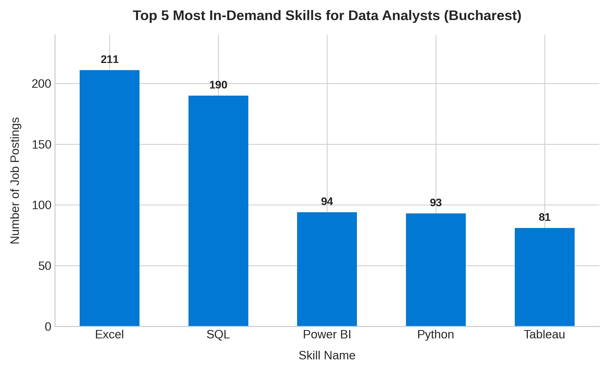
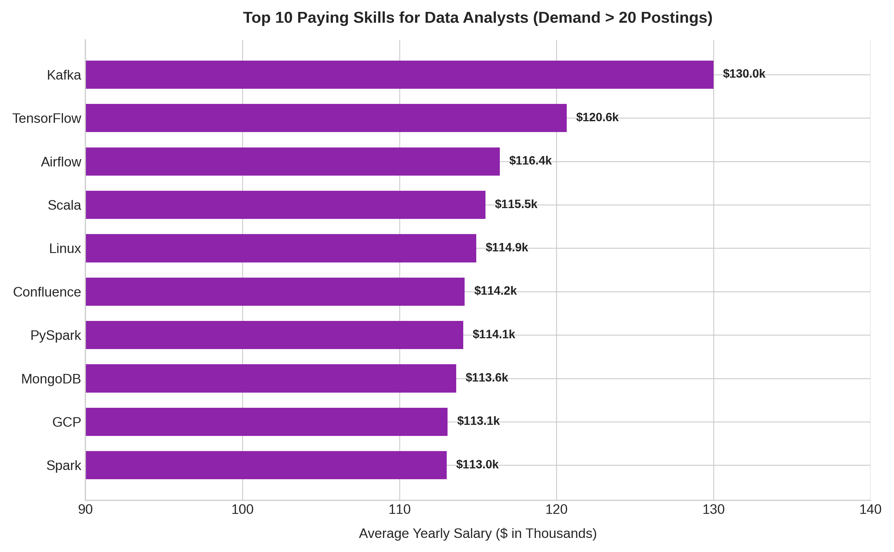
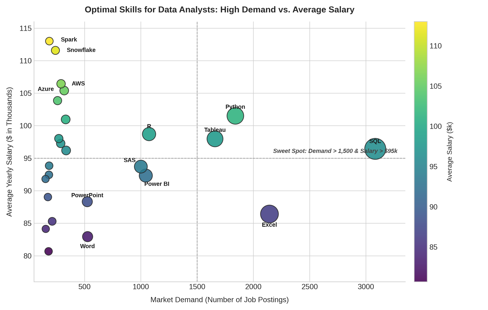

# Data Analyst Job Market Analysis (2023)


## Introduction

Dive into the data job market! Focusing on Data Analyst roles, this project explores top-paying positions, in-demand skills, and the optimal intersection where high market demand meets top compensation.


All SQL queries and data scripts can be found here: [project_sql folder](/project_sql/)


## Background

Driven by a quest to navigate the data analyst career path more strategically, this project pinpoints high-paying and high-demand skills to uncover what the market actually values.


The dataset contains global tech job postings from 2023, specifically filtered and analyzed for the **Data Analyst** role.


### Key Questions Explored:

1. What are the top-paying remote Data Analyst jobs?

2. What skills are required for these top-paying jobs?

3. What are the most in-demand skills for Data Analysts overall?

4. Which skills correlate with the highest salaries (filtering out statistical outliers)?

5. What are the most optimal skills to learn (high demand + strong compensation)?


---


## Tools Used

- **SQL:** The primary querying language used to aggregate, filter, and extract insights.

- **PostgreSQL & pgAdmin 4:** Relational database management system used to host and model the star schema dataset.

- **Visual Studio Code:** Primary environment for writing queries and managing project scripts.

- **Git & GitHub:** Version control, documentation, and portfolio hosting.


---


## The Analysis


### 1. Top-Paying Data Analyst Jobs

To uncover the highest-paying roles, data analyst positions were filtered by remote availability (`'Anywhere'`) with explicit yearly salaries.


```sql

SELECT 

    j.job_id,

    j.job_title,

    j.job_location,

    c.name AS company_name,

    j.job_schedule_type,

    j.salary_year_avg,

    j.job_posted_date

FROM

    job_postings_fact AS j

LEFT JOIN 

    company_dim AS c ON j.company_id = c.company_id

WHERE 

    j.job_title_short = 'Data Analyst' 

    AND j.salary_year_avg IS NOT NULL 

    AND j.job_location = 'Anywhere'

ORDER BY 

    j.salary_year_avg DESC

LIMIT 10;

```


#### Results:





#### Key Insights:

* **Seniority Commands the Ceiling:** Senior, Principal, and Director titles dominate the top 10, regularly clearing $185,000 to over $300,000.

* **Top Remote Pay is Global:** Fully remote (`Anywhere`) postings from major tech companies (Meta, Pinterest) compete directly with executive-level packages.

* **Outliers Exist:** Mantys represents an extreme outlier at $650k, highlighting the need to look at broader sample sizes when evaluating compensation benchmarks.


---


### 2. Skills Required for Top-Paying Jobs

Using the top 10 highest-paying roles identified in Query 1, this query looks up which technical skills appeared most frequently in those listings.


```sql

SELECT 

    s.skills AS skill,

    COUNT(*) AS times_mentioned

FROM (

    SELECT 

        j.job_id

    FROM

        job_postings_fact AS j

    WHERE 

        j.job_title_short = 'Data Analyst' 

        AND j.salary_year_avg IS NOT NULL 

        AND j.job_location = 'Anywhere'

    ORDER BY 

        j.salary_year_avg DESC

    LIMIT 10

) AS j

INNER JOIN skills_job_dim AS sj ON j.job_id = sj.job_id

INNER JOIN skills_dim AS s ON sj.skill_id = s.skill_id

GROUP BY 

    s.skills

ORDER BY 

    times_mentioned DESC;

```


#### Results (Top Mentioned):





#### Key Insights:

* **The High-Pay Core:** **SQL (80%)**, **Python (70%)**, and **Tableau (60%)** are practically mandatory in top-tier analyst postings.

* **Modern Cloud Stack:** Technologies like **Snowflake**, **AWS**, and **Azure** appear consistently, indicating that high-paying roles expect fluency in modern cloud data infrastructure.

* **Collaboration Tools:** Tools like **Jira**, **GitLab**, **Confluence**, and **Bitbucket** demonstrate that high-compensation roles require strict agile and version-controlled engineering standards.


---


### 3. Most In-Demand Skills for Data Analysts

To look beyond high-salary niches and identify overall industry demand, this query tallies the most requested skills across all Data Analyst job postings.


```sql

SELECT 

    s.skills AS skill_name,

    COUNT(sj.job_id) AS demand_count

FROM 

    skills_job_dim AS sj

INNER JOIN job_postings_fact AS j ON sj.job_id = j.job_id

INNER JOIN skills_dim AS s ON sj.skill_id = s.skill_id

WHERE 

    j.job_title_short = 'Data Analyst'

GROUP BY 

    skill_name

ORDER BY 

    demand_count DESC

LIMIT 5;

```


#### Results:





#### Key Insights:

* **SQL is #1:** With over 3,000 mentions, SQL is the single most essential prerequisite for landing a data analyst position.

* **The Persistence of Spreadsheets:** Excel remains in high demand (> 2,100 mentions), serving as a core operational tool across non-tech and legacy business sectors.

* **Scripting Over Spreadsheets:** Python and R demonstrate massive market volume, establishing that code-first analytics is now standard practice.


---


### 4. Top-Paying Skills (Filtered for Statistical Reliability)

Filtering out single-mention outliers (`HAVING COUNT(j.job_id) > 20`) reveals which skills consistently yield the highest compensation across meaningful sample sizes.


```sql

SELECT 

    s.skills AS skill_name,

    COUNT(j.job_id) AS demand_count, 

    ROUND(AVG(j.salary_year_avg), 2) AS average_salary

FROM 

    job_postings_fact AS j 

INNER JOIN skills_job_dim AS sj ON j.job_id = sj.job_id

INNER JOIN skills_dim AS s ON sj.skill_id = s.skill_id

WHERE

    j.job_title_short = 'Data Analyst' 

    AND j.salary_year_avg IS NOT NULL

GROUP BY 

    s.skills

HAVING

    COUNT(j.job_id) > 20

ORDER BY

    average_salary DESC

LIMIT 10;

```


#### Results:





#### Key Insights:

* **Big Data & Streaming Lead:** **Kafka** ($130k), **Airflow** ($116k), and **Spark / PySpark** (~$113k–$114k) represent the highest-earning category.

* **Machine Learning Premium:** Frameworks like **TensorFlow** ($120.6k) prove that analyst roles overlapping with Data Science expectations earn top-tier pay.

* **Systems Literacy:** Understanding operating systems and cloud environments (**Linux**, **GCP**) reliably lifts compensation past the $110,000 threshold.


---


### 5. Optimal Skills to Learn (High Demand + High Salary)

To determine the best return-on-investment (ROI) for an aspiring analyst, this query identifies skills that balance high market demand with above-average salaries.


```sql

SELECT 

    s.skills AS skill_name,

    COUNT(j.job_id) AS demand_count, 

    ROUND(AVG(j.salary_year_avg), 2) AS average_salary

FROM 

    job_postings_fact AS j 

INNER JOIN skills_job_dim AS sj ON j.job_id = sj.job_id

INNER JOIN skills_dim AS s ON sj.skill_id = s.skill_id

WHERE

    j.job_title_short = 'Data Analyst' 

    AND j.salary_year_avg IS NOT NULL

GROUP BY 

    s.skills

ORDER BY

    demand_count DESC,

    average_salary DESC

LIMIT 10;

```


#### Results:





#### Key Insights:

* **The Sweet Spot (SQL + Python + Tableau):** This trio delivers the highest ratio of job opportunities to compensation, with Python crossing the six-figure mark ($101.5k) alongside high volume.

* **Tableau vs. Power BI:** Tableau edges out Power BI in both posting demand (1,659 vs. 1,044) and compensation (~$98k vs. ~$92k).

* **The Code Dividend:** Transitioning from Excel ($86.4k) to Python ($101.5k) yields a ~$15,000 average salary increase, proving that programming ability is the fastest lever for compensation growth.


---


## What I Learned

Throughout this project, I strengthened both my technical execution and analytical thinking:

- **Advanced SQL Querying:** Designed subqueries, CTEs, multi-table inner/left joins, and aggregate functions (`GROUP BY`, `HAVING`) across relational tables.

- **SQL Execution Logic:** Mastered how the database engine filters and evaluates conditions under the hood (the strict order: `FROM` -> `WHERE` -> `GROUP BY` -> `HAVING` -> `SELECT` -> `ORDER BY`).

- **Data-Driven Critical Thinking:** Learned to spot and handle statistical outliers (such as N=1 entries distorting salary averages) using sample-size filters (`HAVING COUNT(*) > 20`).

- **Real-World Business Translation:** Converted raw query results into strategic career takeaways and executive-ready documentation.


---


## Conclusions

1. **Master the Fundamentals First:** For anyone entering data analytics, **SQL, Excel, Python, and Tableau** are non-negotiable. They account for the overwhelming majority of all job openings.

2. **Move Beyond Spreadsheets Early:** While Excel opens the door to entry-level roles, programming languages (Python, R) and cloud tools unlock the $100k+ compensation tier.

3. **Specialization Pays:** The highest-paying analyst roles blend data analysis with **Data Engineering** (Airflow, Spark, Kafka) and **Cloud Warehousing** (Snowflake, GCP).